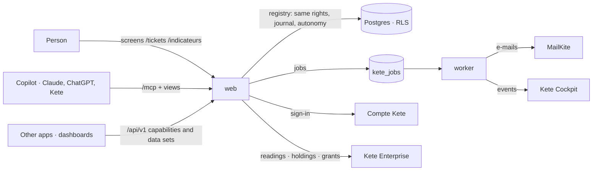
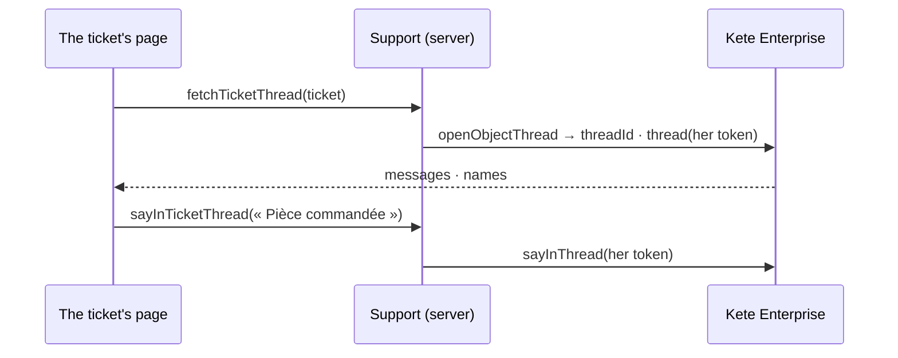
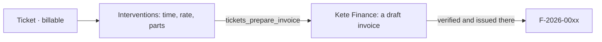

# kete-helpdesk

The tickets of any support desk — after-sales, IT support, general services — for any
organization: queues, a criticality grid that sets each ticket's deadline, a clock that runs from
acknowledgement to restoration with motivated suspensions left out, and the indicators that come
out of it, sent to Kete Enterprise as readings. See [a ticket's life](docs/flows/ticket-life.md)
and [an agent opens a ticket](docs/flows/ticket-opened-by-agent.md).

Born from the Kete template: it signs people in with the Compte Kete, keeps each organization's
data apart, journals every gesture, lets agents prepare and people decide — on its screens and in
their copilot (MCP Apps).



**Integrated by its card** (`/.well-known/kete`, kete-core specs 045 and 049): its tools
(`ticket_list`, `ticket_get`, `tickets_open`), its data set `tickets`, its API, and its permissions
with their words — Kete Enterprise grants them to positions in Administration › Rights; once it
does, Support follows those grants instead of its defaults. See
[rights from Kete Enterprise](docs/flows/rights-from-enterprise.md).

## Run locally

```bash
# Once per machine: a GitHub token with read:packages, kept in your user configuration.
pnpm config set "//npm.pkg.github.com/:_authToken" <token>
pnpm install
cp .env.example .env   # then fill it: database, Compte Kete registration, session secret
pnpm db:migrate
pnpm dev               # http://localhost:3400
pnpm worker            # in another terminal: e-mails and events
pnpm demo              # http://localhost:3441 — an after-sales desk at work, in a throwaway schema
```

`pnpm demo` needs only the two test addresses of `.env` (`KETE_TEST_OWNER_URL`,
`KETE_TEST_APP_URL`). It opens as the head of after-sales: two queues, four tickets, one billable
intervention ready to be invoiced in Kete Finance (`db/demo/seed.ts`); its schema is dropped when it
stops.

**Joined to the whole platform** (kete-core's `pnpm platform`, `KETE_DEMO_JOINED=on`): the app signs
people in through the local Compte Kete, its data are seeded in that Compte Kete's « KYA démo »
organization — seeded as the app alone, then its screens speak to the center and the other apps —
and the person signed in is its owner. It then answers on `http://127.0.0.1:<port>`, the loopback
address the Compte Kete accepts for a client's return.


**Its thread at the center** (Kete Enterprise spec 098): a ticket's thread is born at the center when it is opened (`@kete/center`'s `openObjectThread`, with the person's token) and opened again from « Fil du ticket »; without a center, there is none and Support works alone.

**Its thread, beside the ticket** (spec 008; kete-core spec 141): the ticket's page shows that
thread — the same conversation as « Fils » at the center, drawn by `@kete/conversation` — and she
answers in it with the one composer (`@kete/center`'s `thread` and `sayInThread`, with her token).


## Test

```bash
pnpm test              # a Neon "test" branch, or KETE_TEST_POSTGRES=container
pnpm typecheck
```

## Deploy

The repository's secret `KETE_PACKAGES_TOKEN` (read:packages) lets CI read kete-core's packages;
the image receives it as the build secret `node_auth_token`. One image, two roles (doctrine
ARCHITECTURE_APP §9): the web process (`pnpm start`, migrations at
start-up) and the worker (`pnpm worker`). An operator registers the app at the Compte Kete
(client id and secret) and declares it in Kete Cockpit (its events key).

## Its rights

| Role | tickets:read | tickets:write | tickets:manage (queues, indicators) |
| --- | --- | --- | --- |
| owner, admin | yes | yes | yes |
| member | yes | yes | no |

## Its tickets in the center's index (spec 009)

Support declares its kind « ticket » in `kete.json` (`objects`) and, with its holdings, says its open
tickets and those ended this week to Kete Enterprise's index (kete-core `sayObjects`): « # », the
search, Kete and the agents of the center find them with each person's own rights. The ticket's
data stays here.

## Who pays (spec 005)

A ticket says who pays — warranty, maintenance contract, or billable to the client. Its
interventions (time, rate, parts) are recorded with their cost; a billable ticket's become a
draft invoice in **Kete Finance**, asked with the person's token and issued there by who issues
invoices. `FINANCE_URL` names Kete Finance's address; without it, nothing is prepared.


