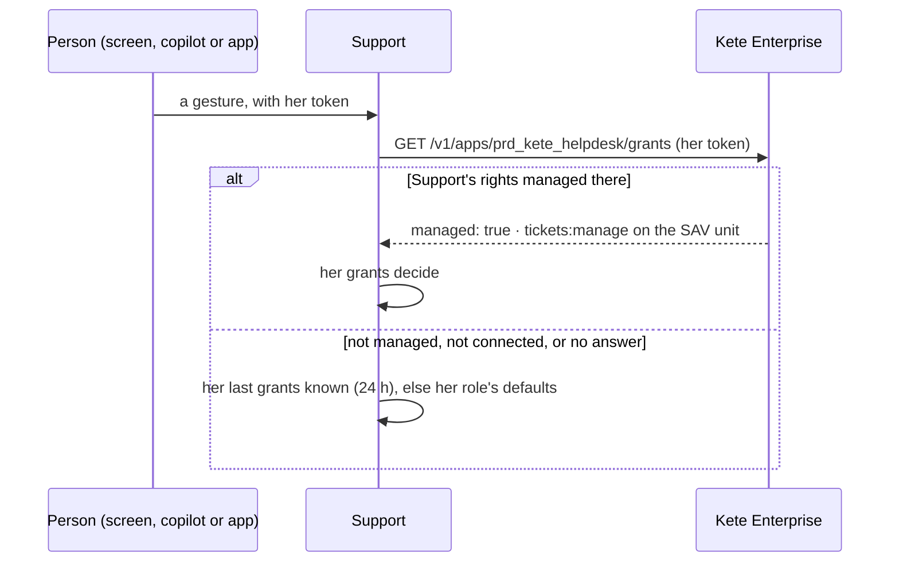

# Rights granted in Kete Enterprise

Support declares its permissions in `features/tickets/policies.ts`, with their words in French and
English and the Compte Kete roles that hold them by default (kete-core spec 049). Kete Enterprise
reads them from the card; an administrator puts them in roles, granted to positions.

| Permission       | By default            | What it allows                                       |
| ---------------- | --------------------- | ---------------------------------------------------- |
| `tickets:read`   | owner, admin, member  | the queues' tickets, their steps and deadlines       |
| `tickets:write`  | owner, admin, member  | open, acknowledge, suspend, restore a ticket         |
| `tickets:manage` | owner, admin          | queues, their indicators, readings to Kete Enterprise |
| `journal:read`   | owner, admin          | who did what, agents included                        |
