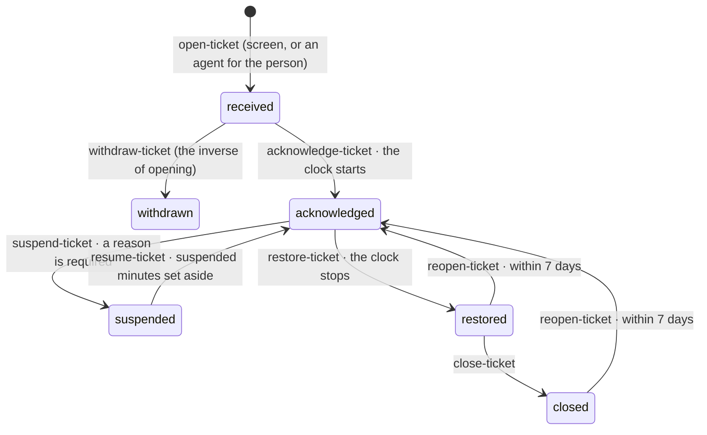
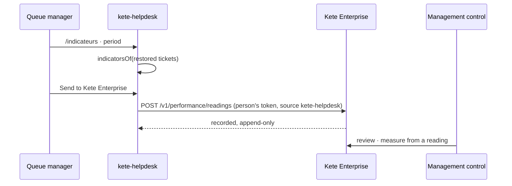
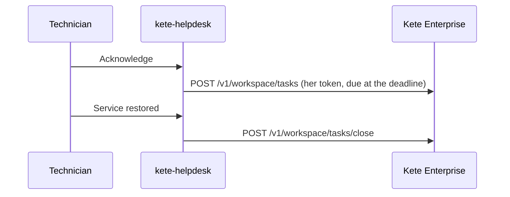

# A ticket's life and its clock

A ticket lands in a queue (after-sales, IT support, general services…) with a criticality chosen
from a grid. Each criticality has its target, from acknowledgement to restoration: critical 4 h,
major 8 h, standard 24 h, minor 120 h (five working days). The clock starts at the
acknowledgement, never at the request, and stops at the restoration of the service, never at the
administrative closing. A suspension waits for a third party or the requester: it is dated and
motivated, and its minutes do not count. A ticket restored less than seven days ago may be
reopened; after, it is a new one. A ticket opened by mistake is withdrawn before anyone takes it.

Every step is a journaled command (`@kete/commands`), refused when the ticket is not at the step
it needs (`wrong_step`), with the person's rights only.

## The indicators, sent as readings

For each queue and period, the tickets restored in it give two shares: restored within their
criticality's target, and reopened within seven days. A queue names the organization's
indicators it feeds, as they are written in its referential. Someone who manages the queues sends
them to Kete Enterprise as readings, with their own access token: management control there takes
a reading into a review, or not.

Without `ENTERPRISE_API_URL`, the indicators stay in the app.

## The ticket in its holder's To do in Kete Enterprise

Acknowledged, resumed or reopened, a ticket is a task « Rétablir : … » in its holder's one To do
in Kete Enterprise, due at its criticality's deadline (suspensions added), sent with her token.
Restored, withdrawn, suspended or closed, the task leaves. The central assistant also reaches
this app's tools through its MCP endpoint, with the person's token (Enterprise spec 018).

