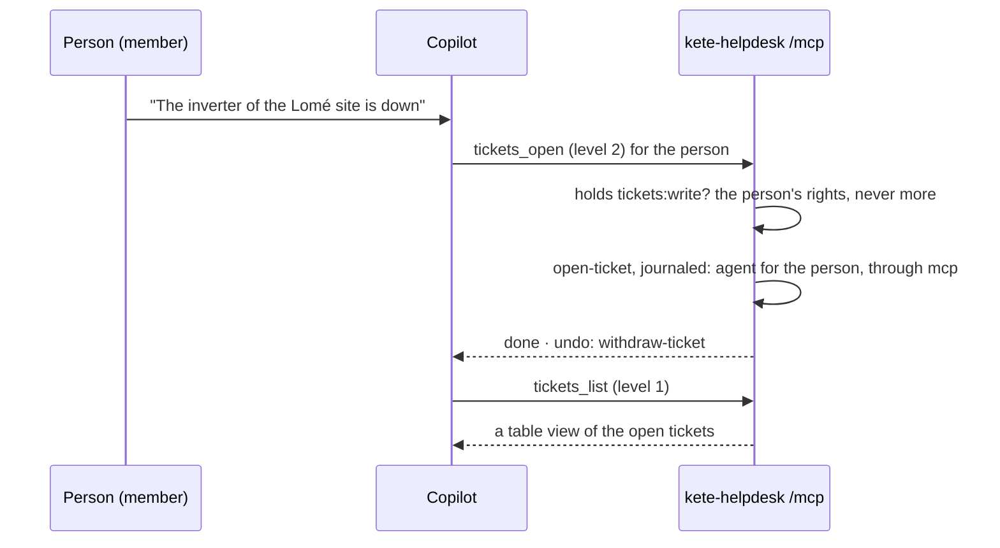

# An agent opens a ticket for a person

Opening is level 2: it commits nothing irreversible, since a ticket nobody has acknowledged yet
can be withdrawn. Every later step is taken by a person on the ticket's screen.
