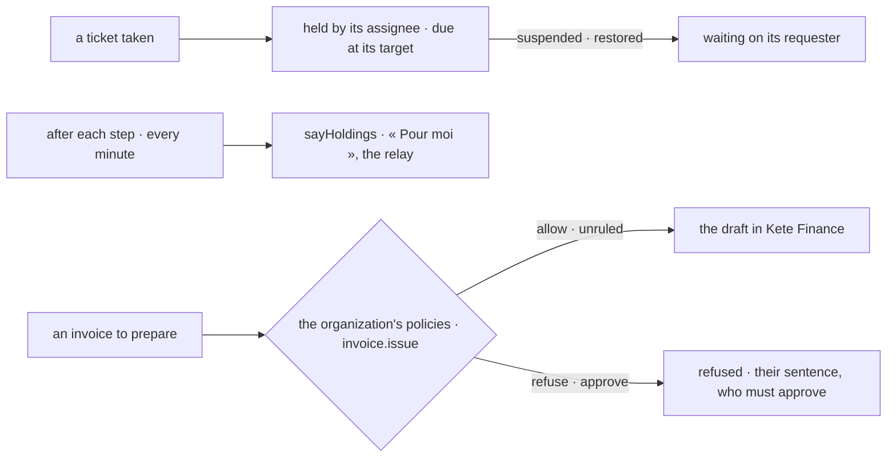

# Spec 006 — Support on the living model

Step **A5** of Kete's release (the doctrine's `FEUILLE_DE_ROUTE.md`; kete-core spec 114; Kete
Enterprise spec 091). The author's go came on 2026-10-17 (« Passe à A5 : les quatre apps du centre
sur le modèle unifié »).

## Why

A ticket taken was a task in its holder's To do in Kete Enterprise (its spec 018): it never waited
on anyone, was never relayed when its holder was away, and left the To do when suspended. A
policy written at the center did not decide an invoice prepared from here.

## Requirements

- **FR-001 — What Support holds** replaces the tasks it sent: a ticket taken is its assignee's,
  due on the day of its target (its criticality's hours plus what it waited suspended); suspended
  or restored, it waits on its requester — unless the requester is who holds it. A ticket nobody
  took has no holder yet: it stays in its queue. Said after each step of a ticket and every minute,
  for each organization with a ticket still open (migration 0005).
- **FR-002 — An invoice through the policies.** Preparing a billable ticket's invoice is an
  `invoice.issue` on its client (else its project, else `prd_kete_helpdesk.invoice`) with the amount
  of its interventions. `refuse` stops it with the policies' sentences; `approve` stops it saying
  who must approve; `allow` or `unruled` prepares the draft in Kete Finance as before.
- Every word from the catalogs.

## Proof

- Tests: no holding for a ticket nobody took, then its assignee's once taken — due, with its
  address, in the shape of `holding.v1`; still hers when suspended by its own requester; an invoice
  refused by a policy with its sentence, Kete Finance never asked.

## Not done here

A queue's holder for the tickets nobody took yet; an approval opened as a card at the center.
