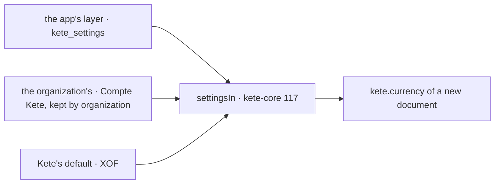

# Spec 007 — Support's settings on Kete's declarations

A6 of Kete's release (doctrine D-060: « aucune app ne lit plus sa devise ou sa langue dans une
variable d'environnement »; kete-core decision 0013, specs 115 to 117). Run on the author's go of
2026-10-17 (« vas au bout »).

## Why

Support read the currency of interventions and of the invoice prepared in Kete Finance from `SUPPORT_CURRENCY`: one value for every organization of a
deployment, set by whoever deploys, unknown to the Compte Kete where the organization says its own.

## Requirements

- **FR-001 — The currency is `kete.currency`**, resolved where the command runs: as Support sets it
  for the organization (`kete_settings`, journaled), else as the organization set it in the Compte
  Kete, else F CFA. A document keeps the currency it was written in. `SUPPORT_CURRENCY` is gone.
- **FR-002 — The Compte Kete is read at each page**: her theme and preferences come from there
  (they follow her in every app), and the organization's layer is kept for its commands.
- **FR-003 — Storage**: the migration `kete_settings` with its RLS policy and its journal
  (`@kete/settings`).

## Proof

- Typecheck and the existing billing tests: an intervention recorded with no setting is in F CFA, as before.

## Not done here

« Réglages » in the app's frame comes with the common frame (`@kete/shell`, step C3): until then
the organization sets its currency in the Compte Kete (Mon espace › Paramètres).
