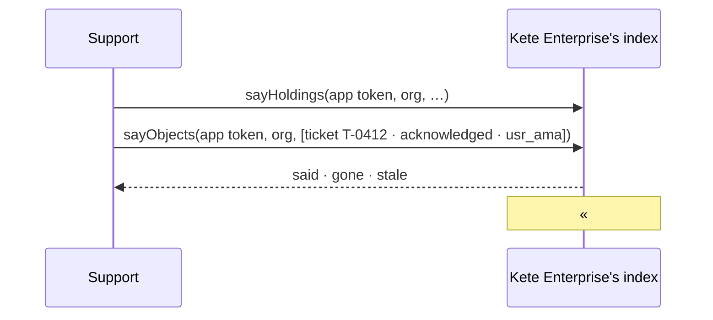

# Spec 009 — Tickets in the center's index

Doctrine D-062 (R1, R3, R15) and kete-core spec 142: every object that matters is in the center's
index, declared once by its owner. Support declares its kind « ticket » in its manifest and says its
tickets to Kete Enterprise's index (its spec 100), so that « # », the search, Kete and the agents of
the center find a ticket with each person's own rights. The ticket's data stays in Support.

## Requirements

- **FR-001** — `kete.json` declares `objects`: the kind `ticket`, its six steps (received,
  acknowledged, suspended, restored; closed and withdrawn end it), its axis `person`.
- **FR-002** — With the holdings, after a step and every minute, Support says to the center the open
  tickets and those ended in the last week: title, step, the person who answers for it (its assignee,
  else its requester), its address, when it last changed. Never fails the gesture it follows.
- **FR-003** — The core packages move to their latest release (sdk 0.18, center 0.10).

## The flow

## Proof

`tests/model.test.ts`: the manifest validates with its kind; a ticket is said in the shape of
`object.v1`, in one of its kind's states.

## Left for later

A ticket carries no party, project, unit nor asset yet (the D-062 audit): with them it would be
filtered by project and seen on its asset's page. A spec of its own.
